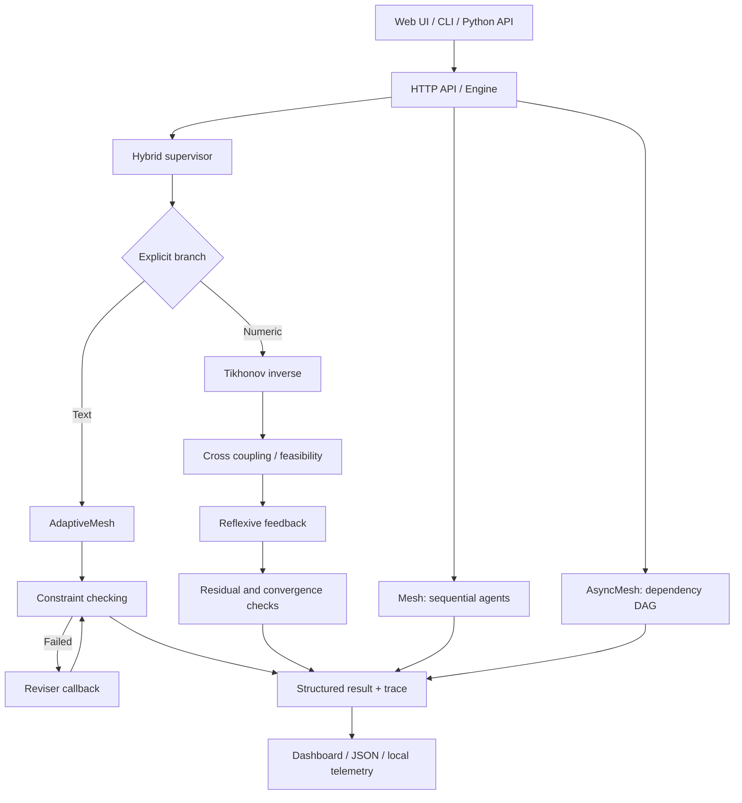

# AgentMesh

**Constraint-aware multi-agent orchestration, inverse control and reflexive supervision.**

[](https://github.com/tlpp7/AgentMesh/actions)
[](LICENSE)


AgentMesh is an open-source Python laboratory for **multi-agent execution, constraint checking, feedback-driven revision and small-scale numeric inverse control**. It includes a local web dashboard, a JSON API, an asynchronous dependency-graph executor and numerical experimentation tools.

> **Scope:** This is a working research prototype, not a production autonomous AI platform. The shipped demonstration agents are deterministic Python functions: they do not query a large language model or prove semantic correctness.

## Quick start (GitHub Codespaces or Linux)

```bash
git clone https://github.com/tlpp7/AgentMesh.git
cd AgentMesh
python3 -m venv .venv
source .venv/bin/activate
python -m pip install -e '.[dev]'
python -m pytest -q
python server.py --host 127.0.0.1 --port 8000
```

Open `http://127.0.0.1:8000`. In **Codespaces**, to open the forwarded web page run `python server.py --host 0.0.0.0 --port 8000`, then open port 8000 from the **Ports** tab and keep its visibility **Private**.

### Available commands

```bash
agentmesh "Design a robust data pipeline" --json
agentmesh "Analyze a system" --contains "Review:" --trace-file runs.jsonl
agentmesh --report runs.jsonl

python examples/async_dag.py
python examples/inverse_control.py
python examples/micro_systemic.py
python examples/adaptive_demo.py
python examples/hybrid_supervision.py
```

## System architecture



### Engine overview

| Component | Module | What it does |
| --- | --- | --- |
| Sequential engine | `src/agentmesh/core.py` | Runs agents and evaluates text constraints with bounded retries |
| Async DAG engine | `src/agentmesh/async_engine.py` | Schedules dependent coroutines with timeouts and concurrency limits |
| Adaptive supervisor | `src/agentmesh/adaptive.py` | Passes failed rules to a reviser; tracks progress and stagnation |
| Hybrid supervisor | `src/agentmesh/hybrid.py` | Unifies text and numeric execution through an explicit dispatch |
| Linear inverse | `src/agentmesh/inverse.py` | Tikhonov regularization, linear coupling and iterative feedback |
| Systemic microprograms | `src/agentmesh/micro.py` | Sensitivity, interval exclusion and sufficient contraction analysis |
| Telemetry | `src/agentmesh/telemetry.py` | Optional local JSONL traces and aggregate reports |
| HTTP backend | `server.py` | Serves the web UI and local JSON endpoints |
| Frontend | `web/` | Navigation, trace inspection, numeric parameters and charts |

## Hybrid supervision

The **text branch** evaluates declared textual requirements and supplies feedback to a deterministic reviser. The **numeric branch** solves a regularized inverse problem and runs bounded feedback against a target. Both return `HybridResult` with `mode`, `accepted`, `output` and `diagnostics`.

```python
from agentmesh.hybrid import run_hybrid

text = run_hybrid(objective="Build a resilient workflow",
                  requirements=["Review:", "Plan:"])
numeric = run_hybrid(matrix=[[1, .3], [.2, 1]],
                     target=[2, 1], gain=.5,
                     lower=[-5, -5], upper=[5, 5])

print(text.to_dict())
print(numeric.to_dict())
```

### Numeric mechanics

Regularized inverse (Tikhonov):

```text
x* = (A^T A + λI)^(-1) A^T y     λ > 0
```

Cross-coupled prediction and reflexive update:

```text
ŷ = W x
x[k+1] = project_bounds(x[k] + η (y - W x[k]))
```

The numerical branch reports a residual, iteration count, sensitivity, interval feasibility status and the sufficient contraction check `||I - ηW||∞ < 1`. **An interval result marked `undetermined` is not a proof of feasibility.** Contraction failure is not proof of divergence. These methods operate on small real-valued vectors; no text-to-vector mapping is provided.

## HTTP API

| Endpoint | Method | Purpose |
| --- | --- | --- |
| `/api/health` | GET | Server status |
| `/api/architecture` | GET | Graph definition |
| `/api/run` | POST | Run `agents`, `adaptive`, `inverse` or `hybrid` mode |

Example request:

```bash
curl -s -X POST http://127.0.0.1:8000/api/run \
  -H 'Content-Type: application/json' \
  -d '{"mode":"hybrid","branch":"numeric","matrix":[[1,0.3],[0.2,1]],"target":[2,1],"gain":0.5}'
```

For text supervision use `{"mode":"hybrid","branch":"text","objective":"Build a pipeline","requirements":["Review:","Plan:"]}`.

## Frontend

The local dashboard provides **Vue générale**, **Graphe d'agents**, **Inversion croisée** and **Traces et métriques**. It can inspect nodes, execute agent demos, edit a 2×2 inverse-control scenario and export JSON from the current session. The historical session list is **not persisted across page reloads**.

The hybrid API is available in the backend; the dedicated hybrid UI controls are still on the roadmap.

## Testing and development

```bash
python -m pip install -e '.[dev]'
python -m pytest -v
```

Tests cover agent execution, DAG dependencies, constraint violations, inverse mathematics, feedback, HTTP responses and UI contracts. GitHub Actions runs a Python version matrix. A successful test suite is **not** evidence of a production security audit or correctness for all matrices and workloads.

## Repository structure

```text
AgentMesh/
├── .github/workflows/ci.yml
├── src/agentmesh/
│   ├── core.py
│   ├── async_engine.py
│   ├── adaptive.py
│   ├── hybrid.py
│   ├── inverse.py
│   ├── micro.py
│   ├── constraints.py
│   └── telemetry.py
├── web/
│   ├── index.html
│   ├── style.css
│   └── app.js
├── server.py
├── examples/
├── docs/
├── tests/
├── pyproject.toml
├── CONTRIBUTING.md
├── SECURITY.md
└── LICENSE
```

## Safety and limitations

- Run the web server locally or in a **private** Codespaces port. There is no authentication or production hardening yet.
- No model API credentials are needed; shipped agents are simulated rule-based components.
- Numeric acceptance describes only specified residual/constraint checks, not the quality of an external decision.
- Arbitrary third-party Python agent callbacks are **not sandboxed**.
- Avoid persisting secrets in JSON traces; review them before sharing.
- No automatic coupling currently exists between LLM outputs and numeric state vectors.

## Roadmap

- [x] Sequential orchestration and constraint checking
- [x] Async dependency DAG
- [x] Numeric inverse, cross sensitivity and reflexive feedback
- [x] Adaptive textual revision with explicit feedback
- [x] Hybrid text/numeric backend and unified result structure
- [x] Local web dashboard and API
- [ ] Dedicated hybrid dashboard controls and comparative benchmarks
- [ ] Pluggable safe LLM/MCP adapters and typed agent-state extraction
- [ ] Persistent runs, authentication, event streaming and production security
- [ ] Better numerical conditioning diagnostics and scale tests

See [hybrid supervisor](docs/hybrid-supervisor.md), [adaptive supervisor](docs/adaptive-supervisor.md), [inverse control](docs/inverse-control.md), [systemic microprograms](docs/micro-systemic.md) and [architecture](docs/architecture.md).

## Contributing

Issues and pull requests are welcome. Read [CONTRIBUTING.md](CONTRIBUTING.md). For security problems, follow [SECURITY.md](SECURITY.md).

Licensed under the [MIT License](LICENSE).
