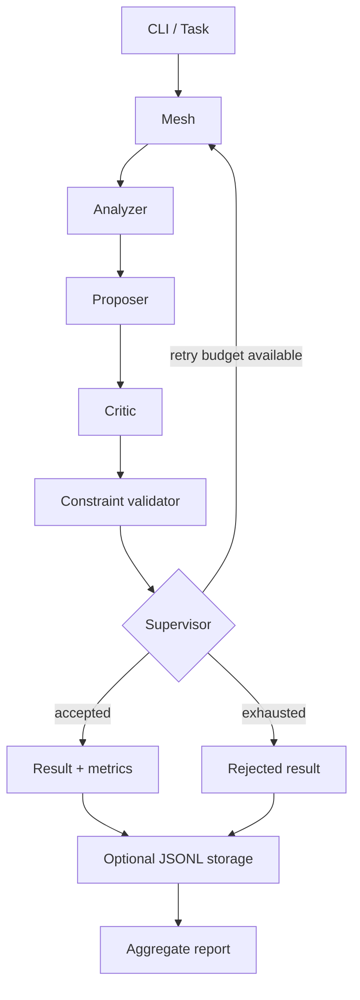

# AgentMesh

Dependency-free local multi-agent orchestration with constraint validation, bounded retries and opt-in JSONL telemetry.


## Quick start

```bash
python -m pip install -e ".[dev]"
python -m pytest -q
agentmesh "Design a reliable data pipeline" --json
```

No API key required. Agents in this release are local deterministic Python functions, not generative LLMs.

## Architecture



## Python API

```python
from agentmesh import Mesh, Task, contains, nonempty
from agentmesh.telemetry import append_result

result = Mesh(max_attempts=2).run(Task("Design a pipeline", [nonempty(), contains("Review")]))
print(result.to_dict())
append_result("runs.jsonl", result)
```

## CLI

```bash
agentmesh "Analyze a system" --json --trace-file runs.jsonl
agentmesh "Analyze a system" --contains "Review:" --max-attempts 2
agentmesh --report runs.jsonl
```

Telemetry is optional and saved only on your computer. Local traces contain task input and agent outputs; avoid storing secrets.

See [architecture](docs/architecture.md), [observability](docs/observability.md), [contributing](CONTRIBUTING.md) and [examples](examples/basic.py).

## Roadmap
- [x] Offline deterministic agents and bounded supervisor
- [x] Constraint helpers, run metrics and opt-in JSONL logs
- [ ] Pluggable LLM providers and MCP
- [ ] Live visual dashboard, async execution and benchmarks

MIT license.
