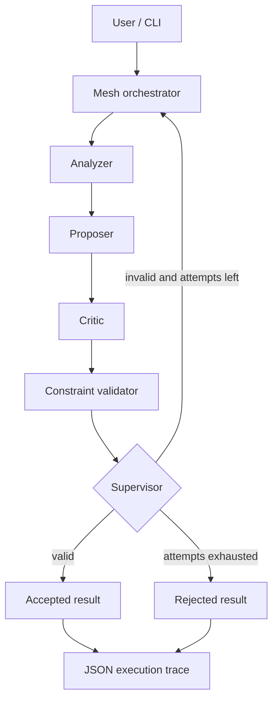

# AgentMesh

Open-source, dependency-free multi-agent orchestration with constraint validation, bounded retries and JSON traces.


## Quick start

```bash
python -m pip install -e ".[dev]"
agentmesh "Design a reliable data pipeline" --json
python -m pytest -q
```

No API key required. The demo uses deterministic local agents, not live LLMs.

## Architecture



## Python API

```python
from agentmesh import Mesh, Task, Constraint

mesh = Mesh()
result = mesh.run(Task("Explain a reliable data pipeline", constraints=[
    Constraint("nonempty", lambda text: bool(text.strip()))
]))
print(result.to_dict())
```

## CLI

```bash
agentmesh "Analyze a system" --max-attempts 3 --json
```

See [architecture](docs/architecture.md), [contributing](CONTRIBUTING.md), [security](SECURITY.md) and [examples](examples/basic.py).

## Roadmap

- [x] Local deterministic agents and bounded supervisor
- [x] CLI, JSON tracing and CI tests
- [ ] Pluggable LLM adapters and MCP connectors
- [ ] Web dashboard and benchmark suite
- [ ] Async execution and observability

MIT license. Contributions welcome.
