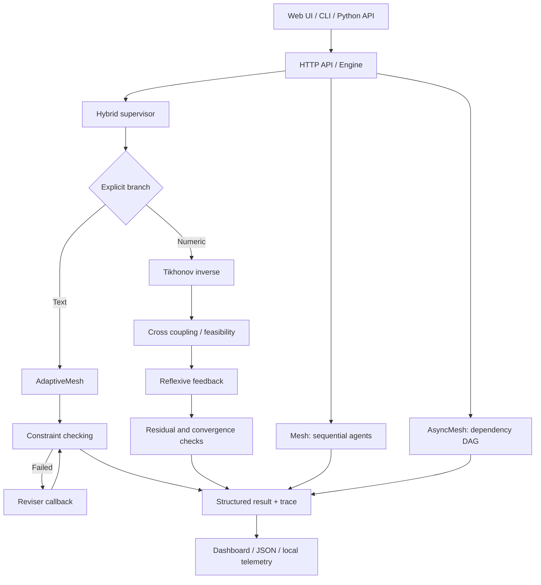
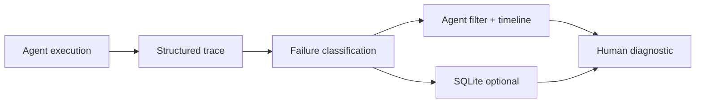

# AgentMesh

**Constraint-aware multi-agent orchestration, inverse control, reflexive supervision and a local web laboratory.**

[](https://github.com/tlpp7/AgentMesh/actions)
[](LICENSE)


AgentMesh is an open-source Python laboratory for **multi-agent execution, constraint checking, feedback-driven revision and small-scale numeric inverse control**. It includes a redesigned local web dashboard, a JSON API, an asynchronous dependency-graph executor, numerical diagnostics, opt-in SQLite run storage and integration contracts.

> **Scope:** This is a working research prototype, not a production autonomous AI platform. The shipped demonstration agents are deterministic Python functions: they do not query a large language model or prove semantic correctness.

## Quick start (GitHub Codespaces or Linux)

```bash
git clone https://github.com/tlpp7/AgentMesh.git
cd AgentMesh
python3 -m venv .venv
source .venv/bin/activate
python -m pip install -e '.[dev]'
python -m pytest -q
python server.py --host 127.0.0.1 --port 8000
```

Open `http://127.0.0.1:8000`. In **Codespaces**, to open the forwarded web page run `python server.py --host 0.0.0.0 --port 8000`, then open port 8000 from the **Ports** tab and keep its visibility **Private**.

### Available commands

```bash
agentmesh "Design a robust data pipeline" --json
agentmesh "Analyze a system" --contains "Review:" --trace-file runs.jsonl
agentmesh --report runs.jsonl

python examples/async_dag.py
python examples/inverse_control.py
python examples/micro_systemic.py
python examples/adaptive_demo.py
python examples/hybrid_supervision.py
```

## System architecture



### Engine overview

| Component | Module | What it does |
| --- | --- | --- |
| Sequential engine | `src/agentmesh/core.py` | Runs agents and evaluates text constraints with bounded retries |
| Async DAG engine | `src/agentmesh/async_engine.py` | Schedules dependent coroutines with timeouts and concurrency limits |
| Adaptive supervisor | `src/agentmesh/adaptive.py` | Passes failed rules to a reviser; tracks progress and stagnation |
| Hybrid supervisor | `src/agentmesh/hybrid.py` | Unifies text and numeric execution through an explicit dispatch |
| Linear inverse | `src/agentmesh/inverse.py` | Tikhonov regularization, linear coupling and iterative feedback |
| Systemic microprograms | `src/agentmesh/micro.py` | Sensitivity, interval exclusion and sufficient contraction analysis |
| Telemetry | `src/agentmesh/telemetry.py` | Optional local JSONL traces and aggregate reports |
| HTTP backend | `server.py` | Serves the web UI and local JSON endpoints |
| Frontend | `web/` | Navigation, trace inspection, numeric parameters and charts |

## Hybrid supervision

The **text branch** evaluates declared textual requirements and supplies feedback to a deterministic reviser. The **numeric branch** solves a regularized inverse problem and runs bounded feedback against a target. Both return `HybridResult` with `mode`, `accepted`, `output` and `diagnostics`.

```python
from agentmesh.hybrid import run_hybrid

text = run_hybrid(objective="Build a resilient workflow",
                  requirements=["Review:", "Plan:"])
numeric = run_hybrid(matrix=[[1, .3], [.2, 1]],
                     target=[2, 1], gain=.5,
                     lower=[-5, -5], upper=[5, 5])

print(text.to_dict())
print(numeric.to_dict())
```

### Numeric mechanics

Regularized inverse (Tikhonov):

```text
x* = (A^T A + λI)^(-1) A^T y     λ > 0
```

Cross-coupled prediction and reflexive update:

```text
ŷ = W x
x[k+1] = project_bounds(x[k] + η (y - W x[k]))
```

The numerical branch reports a residual, iteration count, sensitivity, interval feasibility status and the sufficient contraction check `||I - ηW||∞ < 1`. **An interval result marked `undetermined` is not a proof of feasibility.** Contraction failure is not proof of divergence. These methods operate on small real-valued vectors; no text-to-vector mapping is provided.

## Optional local persistence and diagnostics

SQLite run persistence is **disabled by default**. To enable it locally:

```bash
export AGENTMESH_DB_PATH="$PWD/.local/agentmesh.sqlite3"
python server.py --host 127.0.0.1 --port 8000
```

The backend exposes `GET /api/runs`, `GET /api/runs/<id>` and experimental `GET /api/events` (bounded server-sent notifications). Requests with `mode: diagnostics` provide estimated numerical conditioning and residual information. The browser history and backend SQLite history are separate.

**Optional bearer-token check** is enabled with `AGENTMESH_API_TOKEN`, but the current browser does not provide a token-entry UI. Use a local HTTP client with the Authorization header for protected API calls. This is **not** a full authentication or authorization system: static pages, HTTPS termination, roles, CSRF defense, rate limiting and production hardening are not provided. Keep the port private.

**Integration contracts:** `integrations.py` exposes a typed state vector (`latency_ms`, `error_rate`, `cost_units`, `quality_score`) and allowlisted in-process callback execution requiring approval by default. This is not yet a live LLM or MCP transport.

## Adaptive gain selection and convergence diagnostics

The local API includes `mode: gain_search`: compare a bounded list of candidate feedback gains using the same matrix, target, tolerance and iteration budget. The selector prioritizes **successful convergence**, then fewer iterations, then residual. This is a finite search, not an optimal-control proof. The inverse-control dashboard exposes a gain selector, configurable tolerance and iteration budget, plus a logarithmic/linear plot toggle.

```bash
curl -sS -X POST http://127.0.0.1:8000/api/run \\
  -H "Content-Type: application/json" \\
  -d '{"mode":"gain_search","matrix":[[1,0.3],[0.2,1]],"target":[2,1],"gains":[0.1,0.5,1.0],"tolerance":1e-7,"max_steps":100}'
```

Convergence means the specified numerical residual threshold was reached within the budget, not that a real-world system is reliable. A sufficient contraction certificate does not bound the number of iterations required to meet a chosen tolerance. The demo text agents are deterministic, so repeated classic runs can repeat the same failure; use adaptive mode for explicit marker-based revision.

## HTTP API

| Endpoint | Method | Purpose |
| --- | --- | --- |
| `/api/health` | GET | Server status |
| `/api/architecture` | GET | Graph definition |
| `/api/run` | POST | Run `agents`, `adaptive`, `inverse`, `hybrid`, `diagnostics` or `gain_search` mode |
| `/api/runs` | GET | List recent persistent runs when enabled |
| `/api/runs/<id>` | GET | Fetch a persistent run |
| `/api/events` | GET | Experimental event stream (requires persistence) |

Example request:

```bash
curl -s -X POST http://127.0.0.1:8000/api/run \
  -H 'Content-Type: application/json' \
  -d '{"mode":"hybrid","branch":"numeric","matrix":[[1,0.3],[0.2,1]],"target":[2,1],"gain":0.5}'
```

For text supervision use `{"mode":"hybrid","branch":"text","objective":"Build a pipeline","requirements":["Review:","Plan:"]}`.

## Frontend

The local dashboard provides **Vue générale**, **Graphe d'agents**, **Inversion croisée** and **Traces et métriques**. It can inspect nodes, execute agent demos, edit a 2×2 inverse-control scenario and export JSON from the current session. The browser session history is **not persisted across page reloads**. A separate opt-in SQLite backend history is available through API endpoints.

The **Laboratoire hybride** tab provides controls for comparative text/numeric execution and an exploratory matrix-conditioning estimate. It does not combine incompatible metrics into a single scientific quality score.

## Agent-centric interactive graph

The dashboard now displays a **radial agent topology** with the supervisor at the center, not a linear vertical flow. Select a node to inspect trace events, and use **Replay / Pause / Step / Speed** to examine an execution in sequence. The overview and graph tabs share the same visual playback.

**Important:** This is **post-run trace replay**, not a live event stream during an active Python execution. True live agent updates require instrumented asynchronous events and a streaming API; the current `/api/events` endpoint only polls persisted run changes. The visualization is a conceptual topology, not proof that every displayed edge is used by the underlying sequential engine.

## Execution traces and failure diagnostics

A core product capability inspired by community feedback: **diagnose failed agents instead of debugging blind**.

- Each sequential agent call records its name, attempt, status and measured duration.
- If an agent raises an exception or returns the wrong type, the original Python exception is retained with an attached `agentmesh_trace` attribute.
- Constraint evaluator exceptions appear as typed trace events; the constraint is considered failed.
- The local API returns a structured failed execution for traced agent exceptions; it includes normalized `observability` information without copying agent outputs into the diagnostic events.
- The **Traces et métriques** panel provides an agent filter, event timeline and observable failure summaries.
- Set `AGENTMESH_DB_PATH` to opt in to SQLite run persistence, then use `GET /api/observability` to review saved summaries.



Diagnostics identify **observed failure points**, not guaranteed root causes. Output content is not embedded in normalized events; raw run payloads stored in SQLite can still contain sensitive content. Do not expose the prototype API publicly without appropriate security controls.

## Testing and development

```bash
python -m pip install -e '.[dev]'
python -m pytest -v
```

Tests cover agent execution, DAG dependencies, constraint violations, inverse mathematics, feedback, HTTP responses and UI contracts. GitHub Actions runs a Python version matrix. A successful test suite is **not** evidence of a production security audit or correctness for all matrices and workloads.

## Repository structure

```text
AgentMesh/
├── .github/workflows/ci.yml
├── src/agentmesh/
│   ├── core.py
│   ├── async_engine.py
│   ├── adaptive.py
│   ├── hybrid.py
│   ├── inverse.py
│   ├── micro.py
│   ├── constraints.py
│   └── telemetry.py
├── web/
│   ├── index.html
│   ├── style.css
│   └── app.js
├── server.py
├── examples/
├── docs/
├── tests/
├── pyproject.toml
├── CONTRIBUTING.md
├── SECURITY.md
└── LICENSE
```

## Safety and limitations

- Run the web server locally or in a **private** Codespaces port. There is no authentication or production hardening yet.
- No model API credentials are needed; shipped agents are simulated rule-based components.
- Bearer-token checks are optional and do not constitute production-grade authentication. Keep the interface local/private.
- The SQLite store can contain full prompts and outputs. Do not store sensitive data without an appropriate threat model.
- Numeric acceptance describes only specified residual/constraint checks, not the quality of an external decision.
- Arbitrary third-party Python agent callbacks are **not sandboxed**.
- Avoid persisting secrets in JSON traces; review them before sharing.
- No automatic coupling currently exists between LLM outputs and numeric state vectors.

## Roadmap and completion status

Completed items are checked only when the related capability exists in this repository. Partial work is broken down rather than marked as finished.

- [x] Sequential orchestration, async DAG and constraint checks
- [x] Adaptive textual feedback and hybrid text/numeric supervisor
- [x] **Hybrid dashboard controls and basic comparative diagnostics**
- [x] **Typed agent-state extraction from explicitly supplied metrics**
- [x] **In-process tool allowlist and explicit approval callback**
- [ ] **Real pluggable LLM and MCP transports**, integration testing and secret management
- [x] **Opt-in SQLite persistence and run retrieval**
- [x] **Optional basic bearer-token API check** (local use only)
- [x] **Experimental bounded server-sent event endpoint**
- [ ] **Production security:** robust authentication, roles, HTTPS, rate limiting, secret lifecycle, auditing and security review
- [x] **Exploratory numerical conditioning and residual diagnostics**
- [x] **Finite adaptive gain comparison, configurable tolerance and log-scale residual chart**
- [ ] **Numerical scale testing and robust production-grade SVD**
- [ ] Semantic quality evaluation, persisted browser history, real-time execution graph and deployment hardening

See [hybrid supervisor](docs/hybrid-supervisor.md), [adaptive supervisor](docs/adaptive-supervisor.md), [inverse control](docs/inverse-control.md), [systemic microprograms](docs/micro-systemic.md) and [architecture](docs/architecture.md).

## Contributing

Issues and pull requests are welcome. Read [CONTRIBUTING.md](CONTRIBUTING.md). For security problems, follow [SECURITY.md](SECURITY.md).

Licensed under the [MIT License](LICENSE).
