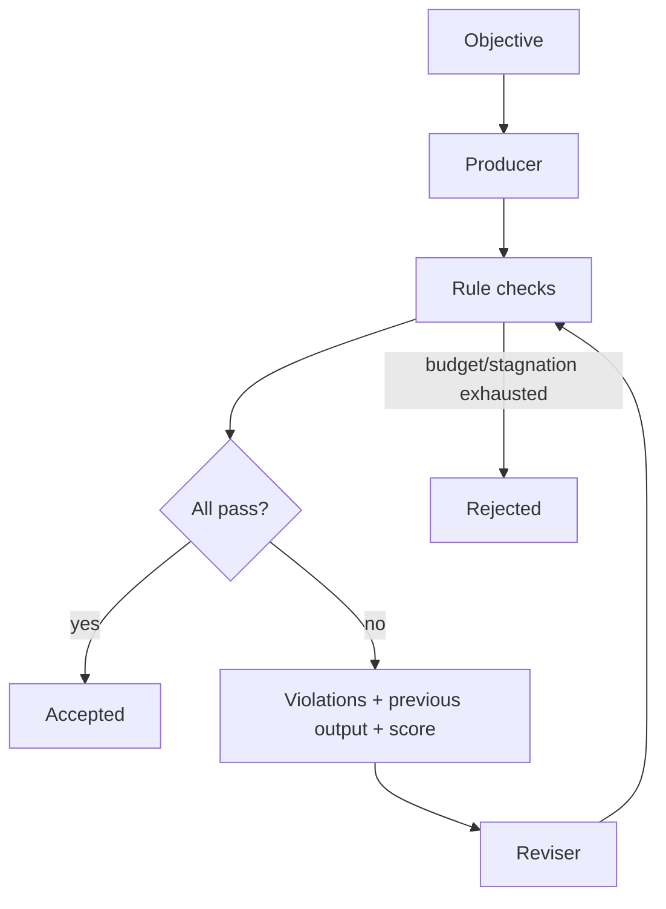

# AdaptiveMesh v0.5 — feedback-guided revisions



The reviser receives explicit failures and earlier output. It is a Python callback, not an LLM. The score is the **fraction of passing rules**, not a general quality metric. Invalid rule checks are conservatively marked failed. Revisions stop when acceptance, budget exhaustion or sustained non-improvement occurs.

```bash
python examples/adaptive_demo.py
python -m pytest tests/test_adaptive.py -q
```

Limitations: synchronous callbacks, no persistence, no external model, no automated semantic judge. Production use needs callback isolation, timeouts and tests of adversarial constraints.
