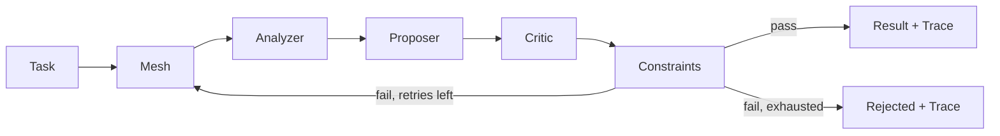

# Architecture

AgentMesh runs a fixed series of local agents and validates their final text against user-defined predicates.

## Guarantees
- Bounded number of attempts.
- Explicit accept/reject status and violations.
- Deterministic offline demo.
- No arbitrary tool execution or network access.

## Current limitations
- Sequential execution only.
- Constraints inspect the final textual output.
- No sandbox for third-party agents: use only trusted Python callables.
- No LLM adapters, distributed execution, or persistent storage yet.
