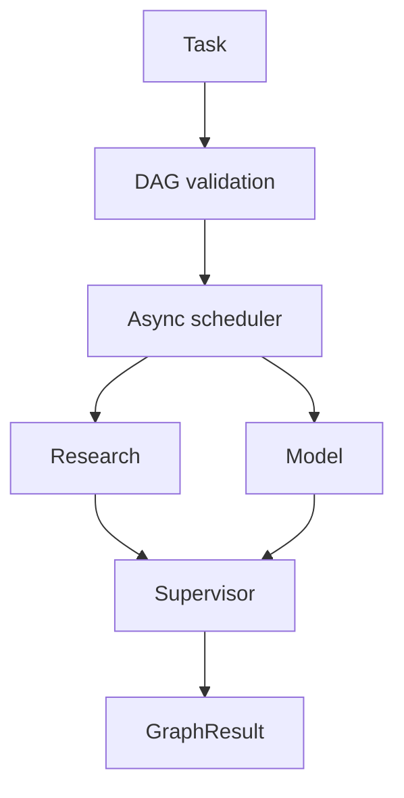

# Experimental async DAG engine

The asynchronous engine is separate from the stable sequential `Mesh` API.



## Run

```bash
python examples/async_dag.py
python -m pytest -q
```

## Python API

```python
import asyncio
from agentmesh.async_engine import AsyncAgent, AsyncMesh

async def worker(inputs, objective):
    return objective.upper()

result = asyncio.run(AsyncMesh([AsyncAgent("worker", worker)]).run("hello"))
print(result.to_dict())
```

## Guarantees

- Detects missing dependencies, self-dependencies and cycles before execution.
- Limits simultaneous agent bodies with an asyncio semaphore.
- Enforces a timeout per agent invocation, not a global run deadline.
- Downstream agents receive outputs from successful dependencies only.
- Returns errors and per-agent timing in a serializable result.

## Limitations

- Agent functions must be async Python callables; blocking code can block the event loop.
- Exceptions are captured in GraphResult; code that consumes it must inspect accepted/errors.
- No distributed workers, persistence or LLM API integration yet.
- Performance tests depend on system scheduling and should not be treated as production benchmarks.
- The async engine does not yet use the v0.2 text-constraint supervisor.
