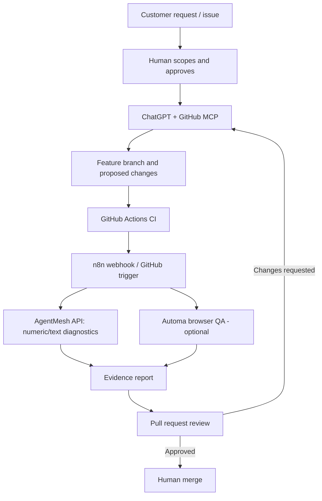

# GitHub MCP × AgentMesh × n8n / Automa

> Integration blueprint; these adapters are **not** shipped as operational connections by default.

## User journey



## Value layers

| Layer | Customer need | Prototype | Acceptance |
| --- | --- | --- | --- |
| Intake | Turn requests into trackable tasks | GitHub Issues and templates | Reproducible request with acceptance criteria |
| Planning | Break down changes | ChatGPT with scoped GitHub MCP permissions | Explicit design, risks, and task list |
| Code | Reproducible changes | Branch + PR, not direct main edits | CI passes; code review |
| Constraints | Detect invalid proposals | AgentMesh adaptive/hybrid API | Failed checks preserved in traces |
| Browser QA | Verify UI behavior | Automa optional workflow | Screenshots/logs linked to commit |
| Operations | Notify stakeholders | n8n approval-first automation | No auto-merge or auto-publish without opt-in |
| Analytics | Follow runtime and quality | AgentMesh diagnostics + run storage | Test count, latency and defects measured |

## n8n starter configuration

1. Create **GitHub Trigger** on issues / pull requests (or a Webhook with authentication and signature validation).
2. Apply an **IF** node filtering event type, repository and a dedicated opt-in label, e.g. `agentmesh-review`.
3. Use **HTTP Request** to call an explicitly reachable AgentMesh API. A Codespaces private port is *not* a public endpoint; use an appropriately secured network path or run both services locally.
4. Use a **Code** or **Set** node to extract a limited set of diagnostic fields. Never send full source or secrets to an untrusted webhook.
5. Open/update a GitHub issue or PR comment for **human review**; do not merge automatically.
6. On error, stop, log the error and notify an authorized owner.

Suggested payload for local text demo:

```json
{
  "mode": "hybrid",
  "branch": "text",
  "objective": "Review a proposed change against acceptance criteria",
  "requirements": ["Review:", "Plan:"]
}
```

**Important:** The current text reviser is deterministic and checks marker presence, **not** semantic quality of source code. Do not report its acceptance as a successful code review.

## Automa browser checks

- Open the local dashboard in a trusted browser context
- Enter an objective and click **Lancer l'orchestration**
- Check visible status, execution trace and structured output
- Open the inverse tab, run the numeric example and capture result
- Capture evidence for manual review
- Optionally send a sanitized status payload to an authenticated n8n webhook

## Access controls

Use least-privilege GitHub authorization. Keep API tokens in protected runtime secrets, never in the frontend or exported workflow. Require approval for write actions. Use private networking, TLS and request validation if leaving localhost. AgentMesh's local bearer check is **not** production authentication.

## Product integrity

The visual promotional material illustrates a proposed product workflow. Current AgentMesh supports local numeric/text demos, HTTP endpoints and prototype diagnostics. Live MCP/n8n/Automa interoperation, autonomous code editing, semantic code review and public production hosting are **future integrations** that require separate implementation and end-to-end tests.
