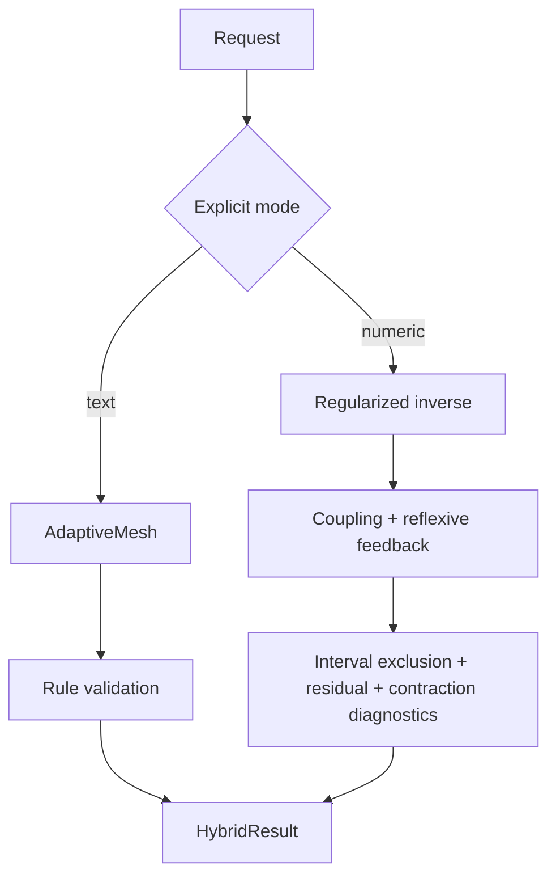

# Hybrid supervisor



## Behavior

Text mode forwards missing textual markers to a deterministic reviser. Numeric mode calculates a regularized inverse, then attempts to reach a target through bounded feedback. It reports whether the loop converged, its residual, a sufficient (not necessary) contraction bound and interval exclusion checks. Nonconvergence or certified infeasibility means the numeric mode is rejected.

The modes have a shared output schema, but **no automatic mapping** from text to numerical state, no neural inference and no LLM provider.

```bash
python examples/hybrid_supervision.py
python -m pytest tests/test_hybrid.py -q
```
