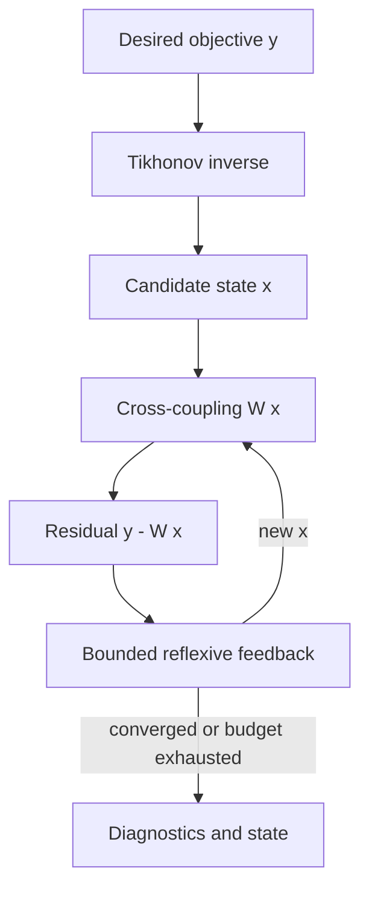

# Inverse, cross-coupled and reflexive controls

This experimental module supports **small, real-valued, numeric state vectors**. It does not interpret text or automatically optimize real-world agents.

- **Inverse:** `x = (AᵀA + λI)⁻¹ Aᵀy`, λ>0. This is regularized least squares, not an exact inverse for arbitrary matrices.
- **Cross-coupling:** `y = W x`; `W[i][j]` is influence of component j on component i.
- **Reflexive feedback:** `x[k+1] = projection(x[k]+gain*(target-W x[k]))`.
- **Guardrails:** dimensions/finite values checked; bounded iteration count; explicit non-convergence result; optional componentwise state bounds.

Convergence is **not guaranteed** for general W or gains. For large or ill-conditioned matrices, use optimized numerical libraries and independent conditioning tests.

Run: `python examples/inverse_control.py`. Tests: `python -m pytest -q`.
