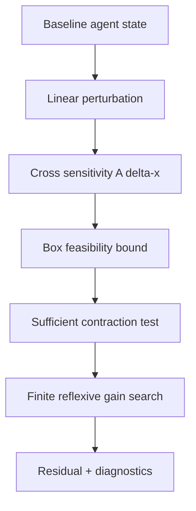

# Inverse systemic microprograms

These experimental tools operate on numerical vectors, NOT directly on human or LLM reasoning.



## Contracts

- `cross_sensitivity(A,dx,x)`: exact first-order effects for a **linear** map and the portion from off-diagonal terms.
- `interval_feasibility(A,lower,upper,y)`: if one output coordinate is outside its interval envelope, **infeasibility is proven**. Otherwise status is **undetermined**, not feasible.
- `feedback_stability(W,gain)`: computes `||I - gain W||_infinity`. If <1, it is a sufficient contraction certificate for the unprojected fixed-point iteration. If >=1, stability is unknown.
- `reflexive_adaptation(W,x,y,gains)`: compares a finite gain set, picks the smallest observed final residual; not a global optimizer.

## Execute

```bash
python -m pytest -q
python examples/micro_systemic.py
```

For large matrices or high reliability, use validated numerical libraries and independent numerical-conditioning analysis.
