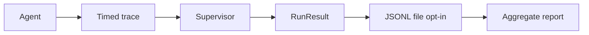

# Observability in AgentMesh 0.2

Metrics are run-local; duration values are informative rather than strict benchmarks.

No network transmission. Use --trace-file to store runs. Note: traces include prompts and outputs; avoid secrets and do not commit local traces.
Agent exceptions are re-raised, not silently converted to successful runs.
